<picture>
  <source media="(prefers-color-scheme: dark)" srcset="./assets/banner-dark.svg" />
  <source media="(prefers-color-scheme: light)" srcset="./assets/banner-light.svg" />
  
</picture>

 

Most of what I build starts out of curiosity and ends up somewhere in these repositories: small tools, rough prototypes, and notes kept along the way.

Nothing is filed under a single label here. Feel free to look around and see what catches your eye.

 

<picture>
  <source
    media="(prefers-color-scheme: dark)"
    srcset="https://raw.githubusercontent.com/Lyywen-Zhang/Lyywen-Zhang/output/github-snake-dark.svg"
  />
  <source
    media="(prefers-color-scheme: light)"
    srcset="https://raw.githubusercontent.com/Lyywen-Zhang/Lyywen-Zhang/output/github-snake.svg"
  />
  
</picture>
